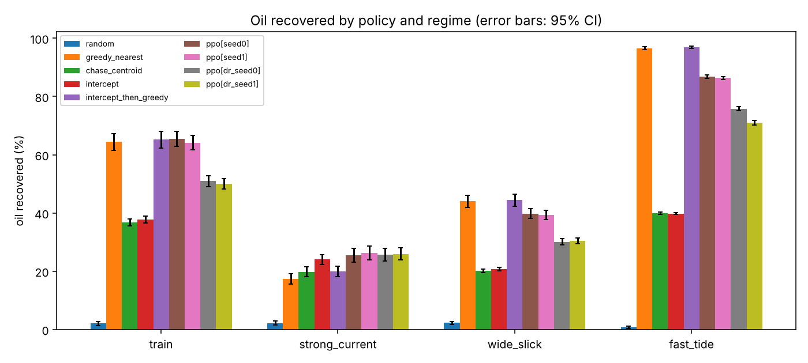
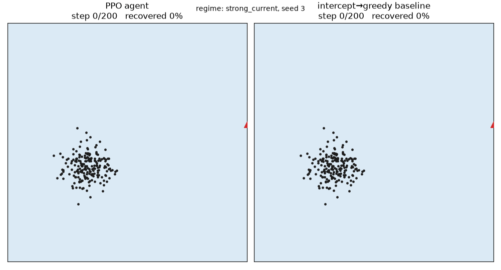

# Skimmer-RL: training an autonomous oil-recovery agent

A self-contained reinforcement-learning project. A simulated oil slick drifts with the current, spreads and rotates with the tide; an autonomous skimmer must recover as much oil as possible in 200 steps. I train a PPO agent **implemented from scratch in PyTorch** and compare it, with confidence intervals, against hand-written planners and on conditions it never trained on.

No dataset, no licences: the simulator generates its own data.



### Watch it run



One strong-current episode, same slick for both (PPO 78.5% vs 51.0%; a hand-picked seed, not the average). Regenerate with `python -m skimmer.visualize --regime strong_current --seed 3`.

## Results (500 identical episodes per cell, mean ± 95% CI)

| Regime | greedy | intercept→greedy (best baseline) | PPO seed0 | PPO seed1 | PPO + domain randomisation |
|---|---|---|---|---|---|
| **train** | 64.4 ± 2.9 | 65.2 ± 2.9 | 65.4 ± 2.6 | 64.1 ± 2.5 | 50.9 / 50.1 |
| strong current | 17.4 ± 1.7 | 20.0 ± 1.8 | **25.4 ± 2.4** | **26.3 ± 2.4** | 25.7 / 25.9 |
| wide slick | 44.0 ± 2.1 | 44.4 ± 2.1 | 39.8 ± 1.7 | 39.3 ± 1.6 | 30.1 / 30.4 |
| fast tide | 96.6 ± 0.5 | 96.9 ± 0.4 | 86.8 ± 0.5 | 86.4 ± 0.5 | 75.8 / 71.0 |

Random policy: about 2%. Full table: `results/results.md`.

### What this does and does not show (honest reading)
- **The agent learned from nothing**: 2% (random) to 65% in about 6 minutes of CPU training, with no hand-coded strategy. It **ties** the best hand-written planner on the training regime (paired difference +0.3 ± 1.0 points, not significant).
- **It wins only under strong currents** (+2.3 ± 1.2 points over the best baseline, paired). I would call that a modest, plausible edge, not a headline.
- **It generalises worse than the simple heuristic**: on wider slicks (-4.6) and faster tides (-10.1) it falls behind. The heuristic has no learned parameters to go out-of-distribution.
- **Domain randomisation did not help; it hurt.** Training on a mix of regimes (fast tide held out) left the agent weaker everywhere except strong current. My *hypotheses*, not verified: 500 updates is too few for the harder mixture (final training entropy stayed high, ~1.15 vs ~0.9), and mixing regimes whose rewards differ about 3x in scale makes advantage estimates noisy. Testing these (more updates, per-regime normalisation) is the obvious next experiment.
- Caveats: simulator only; two seeds per variant; one network size; no hyperparameter search.

## How it works, and why each piece exists

**The environment (`skimmer/env.py`).** 200 oil particles drift with a current that has random speed and direction per episode, plus tide rotation and diffusion. The skimmer picks one of 9 actions (8 compass directions or hold) each step and captures particles within 2.5 units. Reward = fraction of oil recovered this step minus a small fuel penalty. All environments are stepped as NumPy arrays at once ("vectorised"), which is why training takes minutes: RL needs millions of steps.

**The observation (18 numbers).** Position, time left, oil left, oil density in 8 compass sectors, centroid and nearest particle (relative to the ship), and a current estimate. It mimics what a real vessel's sensors could provide, and the **same** observation feeds the baselines and the agent so the comparison is fair.

**The baselines (`skimmer/baselines.py`) - why they matter.** "The reward went up" proves nothing; "it matches a sensible planner" does. Four are included. The most instructive failure is mine: I first expected the lead-pursuit `intercept` planner (aim where the slick *will* be) to be strongest. It scored about 38% against 64% for the dumb `greedy_nearest`, because aiming at the centre makes the ship hover while the particles are spread out. Only the hybrid (intercept from afar, then greedy) got the best of both. Lesson: test your assumption about what a strong baseline is.

**PPO (`skimmer/ppo.py`) in five ideas.**
1. *Actor-critic*: one head proposes actions, one estimates how good the state is.
2. *Rollouts*: play the current policy in 64 environments for a full episode.
3. *Advantage (GAE)*: "was this action better than the value head expected?" This credit assignment is what lets a reward that arrives much later be traced back to earlier steps.
4. *Policy gradient*: make actions with positive advantage more likely.
5. *Clipping*: limit how far one update can move the policy (ratio clipped to 0.8-1.2) so a noisy batch cannot wreck it.
Supporting details: advantages are normalised, the learning rate anneals linearly, an entropy bonus keeps exploration alive early, and the terminal value is 0 because the observation includes time remaining (so the value at the time limit genuinely is 0).

**Evaluation (`skimmer/runner.py`, `skimmer/evaluate.py`).** Every policy plays the **same 500 seeded slicks** (a *paired* comparison), which makes differences far more precise than comparing two independent averages. Regimes other than `train` test generalisation. RL results vary a lot between seeds, which is why there are two seeds per variant rather than a single lucky run.

## Run it

```bash
pip install -r requirements.txt
pytest -q                                        # 11 tests
python -m skimmer.ppo --updates 500 --seed 0     # ~6 min on CPU
python -m skimmer.ppo --updates 500 --seed 0 --randomize
python -m skimmer.evaluate --policies results/policy_seed0.pt results/policy_dr_seed0.pt
POLICY_PATH=results/policy_seed0.pt uvicorn skimmer.serve:app    # POST /act {"obs":[18 floats]}
```

Included trained weights: `results/policy_seed{0,1}.pt`, `results/policy_dr_seed{0,1}.pt`.

## Ideas to extend (each is a real experiment)
1. Fix domain randomisation: more updates, per-regime reward normalisation, a curriculum.
2. A recurrent policy (LSTM) so the agent can infer the current from history instead of being told.
3. Continuous steering with a Gaussian policy; add a fuel *constraint* instead of a penalty.
4. Compare against a search-based planner (MCTS with the simulator as a model).
5. Export to ONNX, quantise, and measure CPU latency for on-vessel deployment.
